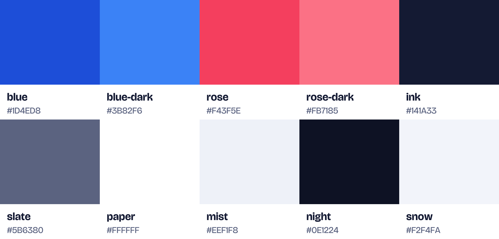

# Nudge brand assets

The mark is a calendar page with today's task checked off. Blue is the brand colour and rose is the accent, used only for the calendar rings and for small highlights.


## Which file to use

| Need | File |
| --- | --- |
| Logo in a header or on a light page | `logo/svg/lockup-horizontal-color.svg` |
| Logo on a dark page | `logo/svg/lockup-horizontal-color-on-dark.svg` |
| Square or centred placement | `logo/svg/lockup-stacked-*.svg` |
| Symbol only (avatars, loaders, small spaces) | `logo/svg/mark-*.svg` |
| Word only | `logo/svg/wordmark-*.svg` |
| One-colour print, embossing, stamps | `*-mono-black.svg` / `*-mono-white.svg` |
| Website favicons | everything in `favicon/` (paste `favicon/head-snippet.html` into `<head>`) |
| iOS / Android / desktop app icon | `app-icon/png/app-icon-1024.png` and its size set |
| Link previews (Open Graph, X, Slack) | `social/og-image.png` (1200×630) |
| Colours in code | `colors/colors.css`, `colors/tokens.css` or `colors/tokens.json` |

Every SVG has its own PNG exports in the matching `png/` folder. Mark PNGs come at 64–1024px. Lockup and wordmark PNGs are named by height (`-128h` = 128px tall).

## Variants

- `color`: for white or light backgrounds.
- `color-on-dark`: lighter blue and rose so the mark holds contrast on dark backgrounds. The wordmark switches to `snow`.
- `mono-black`, `mono-white`, `mono-ink`: one colour, for print or for laying over photos and brand-blue fills.

The check and the divider line are real holes in the shape, so the background shows through on every variant.

## Favicons

- `favicon.svg` switches to the dark colours automatically when the browser is in dark mode.
- `favicon.ico` (16, 32 and 48px) and the 16/32px PNGs use a simpler mark with no divider line and a thicker check, so they stay readable at small sizes.
- `apple-touch-icon.png` (180px), `android-chrome-192/512.png`, `maskable-512.png` and `site.webmanifest` cover home-screen installs.

Copy the contents of `favicon/` to the web root.

## App icon

- `app-icon.svg` / `png/app-icon-*.png`: square with no transparency. iOS and Android apply their own corner mask. Sizes: 1024, 512, 192, 180, 167, 152, 144, 120, 96, 72, 48.
- `app-icon-dark` is the iOS 18 dark-appearance variant.
- `app-icon-maskable` keeps the mark inside the 80% safe zone for Android adaptive icons.
- `app-icon-rounded` has the corners already rounded. Use it in marketing and docs, never as the actual app icon.

## Colours

| Token | Light | Dark-mode equivalent | Use |
| --- | --- | --- | --- |
| blue | `#1D4ED8` | `#3B82F6` | Brand, primary buttons, links, focus ring |
| rose | `#F43F5E` | `#FB7185` | Accent: due today, badges. Use sparingly |
| ink | `#141A33` | `snow #F2F4FA` | Text, wordmark |
| slate | `#5B6380` | `#A3ABC6` | Secondary text |
| paper | `#FFFFFF` | `#171C33` | Cards and surfaces |
| mist | `#EEF1F8` | `night #0E1224` | Page background |



### App colours

Status, Priority and palette colours for the app UI. Each has a `-soft` partner for chip and row backgrounds, and a light and a dark value.

| Token | Use |
| --- | --- |
| `success`, `warning` | Done and success; blocked and warnings |
| `p1` … `p4` | Priority 1 (urgent) to 4 (low) |
| `hue-red`, `hue-orange`, `hue-amber`, `hue-green`, `hue-teal`, `hue-blue`, `hue-violet`, `hue-pink` | The palette Projects, Tags and People pick from |

`colors/tokens.css` defines them as `light-dark()` CSS variables. The frontend copies it to `frontend/src/styles/tokens.css`, and the backend lists the palette keys in `apps/core/palette.py`; change all three together.

## Type

Bricolage Grotesque (wordmark at weight 700, tagline at 450). It's free on Google Fonts under the OFL licence. The wordmark in every file is converted to outlines, so the font doesn't need to be installed to use the logos.

## Clear space and minimum size

- Leave clear space around the logo equal to the height of the calendar rings (about a quarter of the mark's height).
- Show the horizontal lockup at least 24px tall on screen.
- Show the mark on its own at least 16px. Below 32px, use the favicon artwork.

## Don't

- Recolour the mark outside the variants above.
- Stretch, rotate or add shadows or outlines.
- Put the `color` variant on dark backgrounds. Use `color-on-dark` instead.

## Regenerating

`source/build_brand.py` builds every file in this folder from the geometry and colours defined at the top of the script. Run it from the repo root with Python 3 plus `fonttools`, `cairosvg`, `pillow` and `shapely` installed:

```sh
python3 branding/source/build_brand.py branding
```
